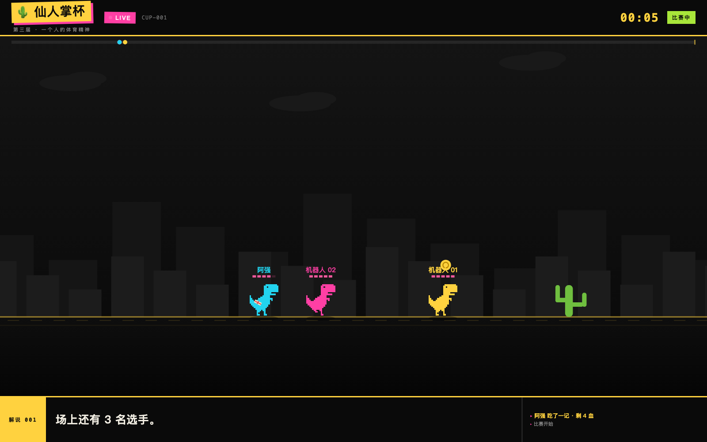
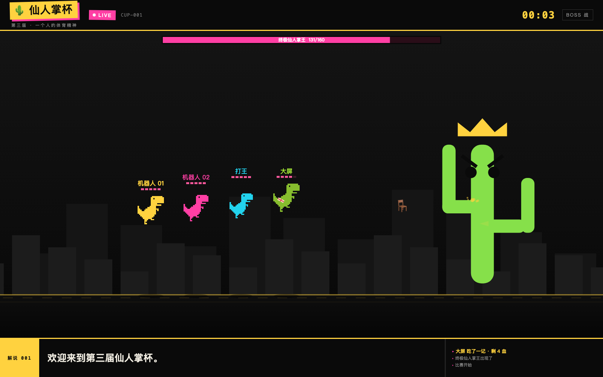
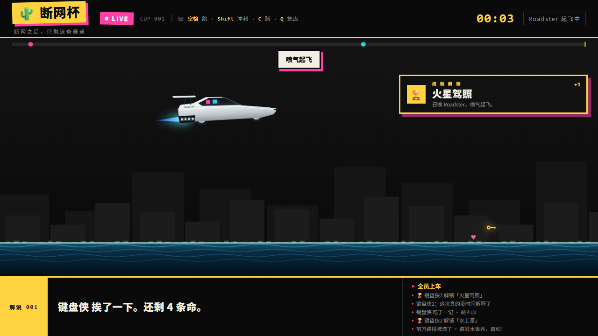
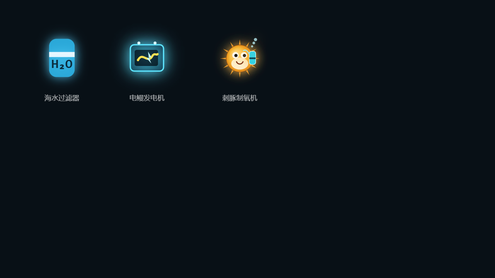
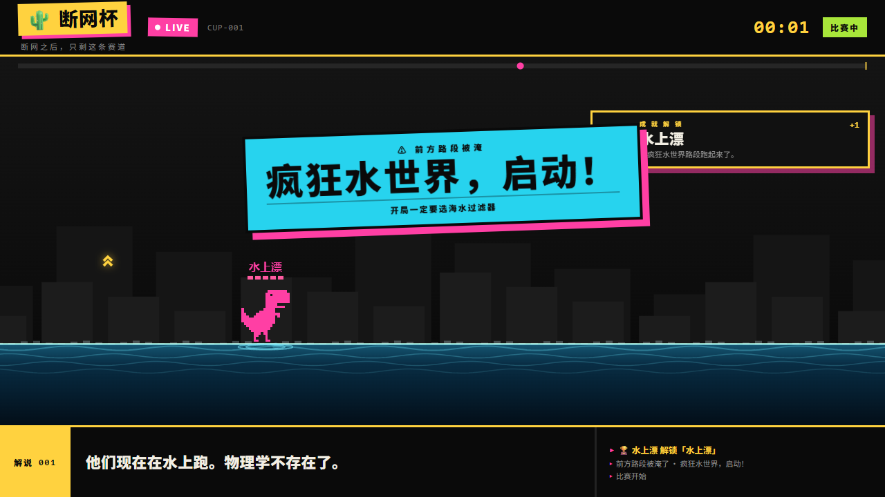
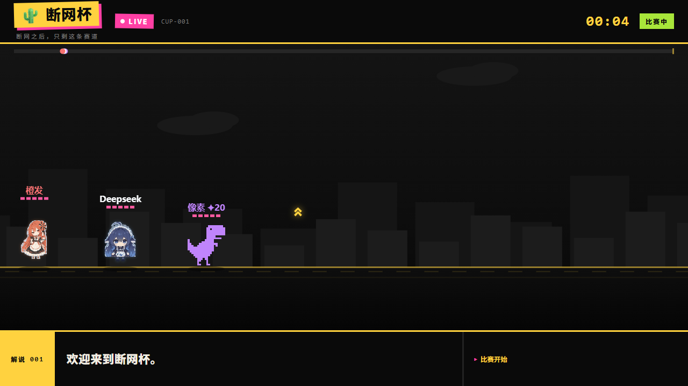

# 🌵 断网杯

> 游戏赛道题解：**断网后的奔跑，是赛博朋克的浪漫与黑色幽默。**

一个「所有人挤在一条赛道上、手机当手柄、解说嘴很碎」的局域网跑酷。
跑到 **1024 米**，终点没有奖杯，只有**终极仙人掌王**——然后它变成横版雷电。
网络断了，直播还在；中间还会路过被淹的**疯狂水世界**，和一辆会喷气起飞的 **Tesla Roadster**。

**云端版：https://duanwang.fiddling.work**（Cloudflare Workers + Durable Objects，不依赖本地电脑；源码在 `cloudflare/`）。
本地离线版仍然零依赖：`node server.js`。





---

## 跑起来

```bash
cd duanwang-cup
node server.js          # 或 npm start
```

- 大屏：**http://localhost:3000**
- 手机：连同一个 Wi-Fi，扫大屏二维码，或开 `http://<笔记本IP>:3000/pad`
- **许愿池**：**http://<笔记本IP>:3000/wish**（大屏二维码切「✨ 许愿」）
- **观众席 / 裁判席**：**http://localhost:3000/background**（多机位分屏，只读）
- 手机是**全屏游戏**：横屏后左下冲刺/下蹲、右下跳，半透明浮在画面上
- 不想掏手机：点「⌨ 键盘入场」；想现场许愿：大屏按 **`W`**
- 二维码由页面内置生成，**不需要 qrencode**，断网也能扫

手机和键盘可以同时在场，机器人在旁边陪跑。

### 飞机/热点模式（一台电脑开房，全舱加入）

- 笔记本开热点（或带旅行路由器），其他人连同一个 Wi-Fi；跑 `node server.js` 即可，**不需要互联网**。
- 二维码/手柄地址会优先选热点网段（Windows ICS `192.168.137.1`、Android `192.168.42/43.x` 等）；如果现场 IP 还是不对，显式指定：
  ```bash
  set HOST_IP=192.168.137.1 && node server.js        # Windows cmd
  $env:HOST_IP="192.168.137.1"; node server.js       # PowerShell
  ```
- Windows 防火墙弹窗选「允许访问」，且网络类型设为「专用」。
- 断网只影响外网；本机 Node、SSE、二维码、许愿解析、所有图片字体都在本地。

### 延迟/手机卡顿处理

- 服务端权威 60Hz，**PC 和手机拿同一份 60Hz 快照**；没有“PC 本地模拟、手机服务端同步”的双标准。
- 逻辑时钟用 5ms 唤醒 + 累加器，不直接依赖 `setInterval(16)`：Windows 上 16ms 定时器实测会掉到 ~34Hz，整局会变慢；现在稳定 60 步/秒。
- SSE 写缓冲超过 64KB 时直接丢旧帧，避免手机 Wi-Fi 慢时消息越堆越多、延迟越玩越大；慢客户端始终拿最新一帧。
- 手机画布做性能自适应：DPR 上限 1.35，掉帧时降到 1x/30fps；去掉 `backdrop-filter` 模糊；`/api/me` 轮询从 420ms 放宽到 750ms。
- 手机端只负责显示和发操作，物理/碰撞/得分都在服务端；因此网络抖动不会让不同选手跑出不同结果。

---

## 观众席

`/background` 是给裁判和观众的第二块屏：每位在场比赛的选手占一格，各看各的视角。

- 人数自适应：1 人满屏、2 人左右分、3–4 人 2×2、5–6 人 3×2、7–8 人 4×2
- 每格带选手名、血量、金币；出局变灰盖 `OUT`，冲线盖 `FINISH`
- 只读、不接收输入，和主屏共用一条 SSE，同一台机器或投到另一块屏都行

---

## 许愿池（许愿式编程，现场版）

不想只当选手？打开 **`/wish`**，用一句中文许愿，比赛里立刻生效：

- 手机：大厅二维码切到「✨ 许愿」，或直接开 `http://<笔记本IP>:3000/wish`
- 大屏：按 **`W`** 现场输入（演示兜底，不依赖手机）
- 支持：仙人掌、按钮失灵、傻瓜弹、金币雨、回血、加速、减速、上天、车钥匙、打王、道具雨、海水过滤器
- 目标：点名 / 全场 / 我 / 第一名 / 他 / 随机
- 规则：每人 5 秒冷却；比赛外不许愿；打王只在 Boss 战生效

解析器是**离线手写规则**（`wish.js`），不联网、不调大模型——断网也能用。
自测：`node test/wish.js`；服务启动后：`node test/wish-live.js`。

---

## 断网后的名场面

### Tesla Roadster 第二代 · 喷气起飞

和尊界 V800 **每局二选一**（都是后半程的稀有钥匙）：

- 捡到 **Roadster 钥匙**（青色发光）→ 手机提示「按 F 起飞」
- 按 F：车从天上降落 → 全员上车 → **垂直点火** → 喷气飞越赛道 → 俯冲撞王
- 撞击扣王 **55 血**（尊界是地面冲撞扣一半），随后进入 Boss 战
- 车上会显示每位乘客的颜色；飞行途中撒金币尾迹

这是「赛博朋克的浪漫」那一半：网络没了，但还有一辆会飞的车。



### 疯狂水世界 · 水上跑

**560–700 米**整段被淹，画风突变：

- 地面变成水面：波纹、浪花、青色水线，脚下有涟漪
- **水世界三件套**：
  - 🌊 **海水过滤器**：+50 金币、+1 血（「年入百万不是梦」）
  - ⚡ **电鳗发电机**：8 秒电力冲刺，撞碎仙人掌，像一块会跑路的移动电源
  - 🐡 **刺豚制氧机**：+2 血，并获得 12 秒氧气泡护盾（挡一次伤害）
- 水面会持续刷三件套/金币/红心/二段跳，不再是空荡荡一段水
- 第一次进水：大屏弹「**疯狂水世界，启动！**」，旁白「他们现在在水上跑。物理学不存在了。」
- 广告牌：「开局一定要选海水过滤器」



这是「黑色幽默」那一半：路被淹了，比赛不暂停，大家在水上继续跑。



### 后半程仙人掌加料

水世界之后（700–1024 米）仙人掌密度明显提高，还会成排出现；后半程不再只有空荡的街道。

### 三种选手形象（64 位像素立绘）

- **经典像素**：Chrome 断网小恐龙，像素块、撞色、三帧跑步。
- 🐋 **Deepseek Chan**：深蓝鲸鱼女仆，白蕾丝头饰、鲸鱼鳍耳、围裙鲸鱼徽章、长卷发。
- 🍊 **橙发女仆**：黑橙女仆装、橙黑玫瑰头饰、手持茶盘。
- 手机入场页可直接选；键盘第 1/2/3 位依次是像素 / Deepseek / 橙发；默认按座位轮换。
- 立绘走「任天堂世代 64 位精灵」路线：有限色板、硬像素边缘、近邻放大，不是平滑矢量。



---

## 操作

| 动作 | 键盘 | 手机 |
|---|---|---|
| 跳 | `空格` | 右侧大按钮 |
| 冲刺 | `Shift` | 左侧「冲刺」 |
| 下蹲 | `C` | 左侧「下蹲」 |
| 滑铲 | `Shift` 后 0.46 秒内按 `C` | 先点冲刺再点下蹲 |
| 整蛊 | `Q` | 底部「整蛊」 |
| 解说语速 | `[` 慢 / `]` 快（默认 1.30x） | — |
| 上载具 / 起飞 | `F`（捡到钥匙后） | 提示按钮 |
| 许愿（大屏） | `W` | 打开 `/wish` |
| 切换镜头（观战） | `A` / `D` 或 `←` `→` | — |
| 返回开始页 | `Esc`（结算页也有按钮） | — |
| 直接看 Boss（演示用） | `B` | — |
| 演示：发 Roadster 钥匙 | `R` | — |
| 演示：跳到水世界 | `T` | — |

**滑铲 5 米**：能撞碎单根的仙人掌（+5 金币）；撞到成排的会碎，但扣 1 血。

---

## 规则

- **5 点血**，被仙人掌或飞刺打中扣 1，身上会多一块创可贴。
- **红心**回 1 血，上限 5；满血时红心不消失，留给别人。
- **金币**：一枚 10 分，只算成绩。
- **电池**：10 秒无敌冲刺，期间撞碎一切。
- **二段跳**（金色双箭头）：捡到就永久解锁，空中再按一次跳会**空翻 360°**；落地后重置，一局内一直有效。
- **解说指令（“禁止跳跃”不是暂停）**：每 12–17 秒，解说会发一条 4.5 秒的离谱公告；跳跃从未被禁用，公告期间起跳算「抗命」，**+3 缺德值**，一局抗命 3 次解锁「不听话」。手机按钮会变成「抗命 +3」——这是送分题，不是晕眩。
- 血掉光就出局，但还能整蛊活着的人。
- 整蛊道具随机三选一，**会先显示在按钮上**：`仙人掌`（空投一根）、`按钮失灵`（改成「提交」）、`傻瓜弹`（全场手机白屏 3 秒）。用完自动重掷。
- 傻瓜弹的旁白只有一句：「**X 说，要有光**」——扔的人自己也瞎。
- 超稀有道具 **~~尊界 V800~~**：**平均三局出一次**，而且只出在**后半程**（58%–88% 路段），路上掉的是**车钥匙**（金色发光）。捡到后手机「整蛊」下方闪烁【按 F 乘坐载具】（TTS 念到品牌时会变成「尊哔——」，并叠一声 1.76kHz 消音哔），大屏同样闪烁提示；按 F 或点提示召唤。点下去 —— 车从画面外滑进来，停在队伍旁边，全员上车（车窗里能看到各自的颜色），然后加速，沿途的仙人掌、风滚草、道具全部撞碎拿走，最后一头撞进仙人掌王身上（1.2 秒撞击特写：车身倾斜、王闪白、`轰！`、金色碎屑、震屏、全员被弹飞落地），**直接扣掉王一半血**，然后进入 Boss 战。
- 旁白：「没时间解释了，快上车」「进步的道路上，怎么能刹车。」
- **Tesla Roadster 第二代**：与尊界每局二选一，同样出在后半程；按 F 后喷气起飞、飞越赛道、俯冲撞王 **55 血**。飞行中撒金币，落地全员 +25 金币。
- **疯狂水世界**：560–700 米被淹，水面上继续跑；**海水过滤器** +50 金币 +1 血；解说会开始念广告词。
- 第一个跑完 1024 米的人触发 Boss；Boss 战里全队一起打。
- 结算页两个按钮：**再来一局**（空格）／**返回开始页**（Esc）。

## 1024 米之后

画面切成固定机位：王在右，人在左，选手悬浮。

- `跳` = 上浮，`下蹲` = 下沉，`Shift` = **扔东西**
- 扔的是随机的奇怪物件：拖鞋、键盘、泡面、椅子、电视、保龄球……伤害 2–9 不等
- 王会吐仙人掌刺，指着人打
- 王 160 血，最后一击的人夺冠

---

## 手感

这一版专门调过“跟手”和“打击感”：

- **60Hz 权威模拟**（原来 30Hz），输入到生效的等待少一半
- **跳跃缓冲**：落地前 140ms 内按跳，落地瞬间自动补跳，不会“按了没反应”
- **命中停顿（hitstop）**：掉血冻结 75ms、撞碎仙人掌 45ms、打中王 26ms、王倒下 240ms
- **屏幕震动**：按事件分档，掉血最重、冲刺最轻
- **受伤红晕 + 王倒下闪白**，撞击点还会迸粒子
- **动作动画**：冲刺拖三道残影和速度线；下蹲是平滑压扁；滑铲压低、旋转、扬尘；落地有压缩和尘土；上升有拉伸
- 键盘按下**立刻**在脚下冒一小股尘，不等服务器回包

---

## 手机端的反馈

- 受伤：全屏红晕 + 画面抖动 + 头顶血条 + 身上贴创可贴 + 震动
- 被整蛊：屏幕红色边框脉冲 + 「你被 X 整啦」+ 震动（两种整蛊都会通知）
- 成就：一行式 toast，最多两条，不挡赛道

---

## 现场保命指南

1. 大屏页先用鼠标点一下——浏览器要一次手势才允许出声。
2. 场地 Wi-Fi 常开 AP 隔离，手机连不到笔记本。带旅行路由器或开热点；二维码指向启动时的 IP，换网要重启。
3. 1024 米大约要跑两分钟，演示时按 `B` 直接看王。
4. 演示新内容：按 `T` 跳到疯狂水世界；按 `R` 发 Roadster 钥匙，再按 `F` 起飞。
5. 关掉的页面 90 秒后自动清人，大厅有「清场」。
6. 一个人也能演示：键盘入场 + 两个人机。
7. 想直接演示二段跳/载具：`POST /api/give {pid, double:true}` / `{pid, roadster:true}`。

---

## 调参

`server.js` 顶部：

```js
const RACE_LEN = 1024;   // 到这里的距离出 Boss
const BOSS_HP = 160;
const BASE_SPEED = 8.6;
const DASH_SPEED = 13.2, DASH_MS = 300, DASH_CD = 1400;
const SLIDE_MS = 470, SLIDE_SPEED = 11.4;
const MAX_HP = 5;
const BATTERY_MS = 10000;
```

台词在 `LINES`，成就表在 `ACH`，掉落权重在 `spawnWorld()`，投掷物在 `THINGS`。

---

## 素材与出处

恐龙是 Chromium 离线页的**官方精灵图**，切片自 `100-offline-sprite.png`：

| | |
|---|---|
| 官方源码 | [`components/neterror/resources/dino_game/`](https://github.com/chromium/chromium/tree/main/components/neterror/resources/dino_game)（`offline.ts` / `trex.ts` / `offline_sprite_definitions.ts`） |
| 精灵坐标 | `tRex: {x: 848, y: 2}`，5 帧、每帧 44×47 |
| 提取版镜像 | [devfolioco/t-rex-runner-game](https://github.com/devfolioco/t-rex-runner-game) |

用了其中 3 帧（站立 / 起跳 / 迈步），按玩家颜色实时着色。

---

## 已知缺口

- 镜头：活着跟自己；出局后自动交给领先的活人，`A`/`D` 手动切换，下一局自动回到自己。Boss 战是固定机位。
- Boss 战只有一种攻击模式（吐刺），没有第二阶段。
- 之前那条「按住变鸟」的 Flappy 模式先下线了，等赛道稳定再以道具形式回来。
- 房间单开、无断线重连；分享图还没做。

---

## PV

`docs/pv.mp4` — 16:9 / 24.8 秒 / 中文旁白 + 字幕。剧本见 `docs/pv-script.md`，字幕 `docs/pv.srt`。
（当前 PV 还是许愿池之前的版本，Roadster / 疯狂水世界待补拍；现场演示以实机为准。）

## 自测

```bash
node server.js          # 另开一个终端
node test/wish.js       # 许愿解析器单测（19 条）
node test/smoke.js      # 无浏览器全流程冒烟（13 条）
node test/features.js   # Roadster / 水世界三件套 / 仙人掌密度 / 形象（19 条，需服务已启动）
node test/wish-live.js  # 许愿接口联调（12 条，需服务已启动）
node test/e2e.js        # 无头 Chrome 跑完整一局（Windows/macOS/Linux 自动找浏览器）
```

`test/e2e.js` 覆盖大厅、入场、跑跳蹲、风滚草、傻瓜弹、尊界过场、撞击、Boss 战、结算，并监听两端 JS 异常；Windows 下如浏览器启动失败，可设 `CHROME_BIN`。

## 目录

```
duanwang-cup/
├── server.js           # 房间、物理、Boss、解说词、SSE、局域网 IP
├── wish.js             # 许愿池：离线中文意图解析（零依赖）
├── public/
│   ├── screen.html / .css / .js   # 大屏：渲染 / TTS / 回放 / 二维码 / W 键许愿
│   ├── pad.html                   # 手机端：全屏画面 + 触控
│   ├── wish.html                  # 手机许愿页
│   ├── shared.js                  # 两端共用的绘制原语（仙人掌/道具/钥匙/车）
│   ├── vendor/qrcode.js           # 内置二维码生成（MIT）
│   └── dino.png                   # 官方精灵切片
├── test/                          # 解析单测 / 冒烟 / 许愿联调 / E2E
├── docs/                          # 截图与 PV
└── HANDOFF.md                     # 交接说明
```
